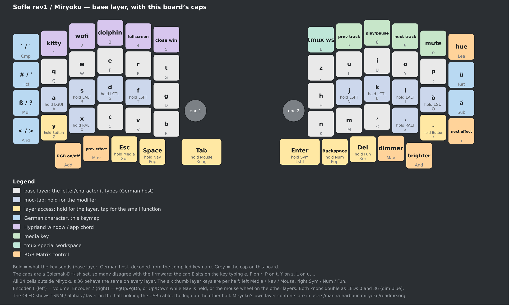

# qmk_userspace — Sofle rev1 / Miryoku

External QMK userspace for a **Sofle rev1** split keyboard running
[Miryoku](https://github.com/manna-harbour/miryoku), with personal hardware
customisations layered on top. See [AGENTS.md](AGENTS.md) for the working notes.

```
keyboards/sofle/keymaps/miryoku/     Sofle keymap: layout mapping + hardware support
users/manna-harbour_miryoku/         vendored Miryoku user space (layer definitions)
qmk.json                             build targets for `qmk userspace-compile` / CI
qmk_firmware/                        git submodule, pinned QMK commit
```

## Pins

| component | version |
|---|---|
| QMK firmware | submodule, `b1aea2556040c28d58d611c8aef0082b5780bb6d` (master, 2026-09-26) |
| Miryoku QMK | vendored from [yehorb/qmk_userspace](https://github.com/yehorb/qmk_userspace/tree/miryoku) @ `2a827f9d0667fb54f355f36ab16b6f76624841a8` (2026-05-27), unmodified |

There is no upstream-maintained Miryoku userspace port yet; the vendored tree is
the current working port (see [miryoku#287](https://github.com/manna-harbour/miryoku/discussions/287)).
When re-vendoring, diff `users/manna-harbour_miryoku/` against upstream and record
the new commit here.

Update QMK deliberately:

```sh
cd qmk_firmware && git fetch --depth 1 origin master && git checkout FETCH_HEAD
cd .. && git add qmk_firmware && git commit -m "chore: bump QMK to <sha>"
```

## Build

Prerequisites: the `qmk` CLI (installed with pipx, see below), `avr-gcc`, and the
submodules QMK needs for AVR:

```sh
pipx install qmk
pipx inject qmk -r "$(realpath qmk_firmware)/requirements.txt" appdirs

git submodule update --init --depth 1 qmk_firmware
cd qmk_firmware && git submodule update --init --depth 1 lib/lufa lib/printf
```

### Local (recommended)

```sh
QMK_HOME="$(realpath qmk_firmware)" QMK_USERSPACE="$(realpath .)" \
  qmk compile -kb sofle/rev1 -km miryoku
QMK_HOME="$(realpath qmk_firmware)" QMK_USERSPACE="$(realpath .)" \
  qmk compile -kb sofle/rev1 -km miryoku -e MIRYOKU_ALPHAS=QWERTY
```

Both variables are set explicitly on purpose: while the old fork still lives at
`~/qmk_firmware`, a bare `qmk compile` resolves `QMK_HOME` to *that* tree.

One-off alternative, if you no longer need to build the old fork:

```sh
qmk config user.qmk_home="$(realpath qmk_firmware)" user.overlay_dir="$(realpath .)"
qmk compile -kb sofle/rev1 -km miryoku
```

### Make wrapper

```sh
make sofle/rev1:miryoku            # forwards to the pinned qmk_firmware
make sofle/rev1:miryoku:flash
make sofle/rev1:miryoku SKIP_GIT=1 # skip QMK's submodule check (no surprise downloads)
```

### All targets / CI

```sh
qmk userspace-compile      # builds everything in qmk.json
```

Pushing to GitHub runs `.github/workflows/build_binaries.yaml`, which builds all
`qmk.json` targets **against the pinned submodule** (the reusable workflow skips
its own `qmk_firmware` checkout when the submodule is present) and publishes a
Release with the hex files. Actions is enabled by default — the first run
happens on the first push.

## Flashing

Both halves run the **same** firmware (`MASTER_LEFT`, no `EE_HANDS`) but are
separate MCUs, so each is flashed over its own USB port, one at a time:

```sh
make sofle/rev1:miryoku:flash SKIP_GIT=1     # per half, from this directory
```

The build runs first, then `dfu-programmer` looks for a board in DFU mode and, if
it finds none, **waits — retrying every 0.5 s**. So the easy workflow is: start
the command, then enter the bootloader on that half while it waits. Three ways
in:

1. **Double-tap the reset button** on that half's Pro Micro (next to the TRRS
   jack) — two quick presses; a single press only restarts the MCU.
2. **Hold the outermost-top key of that half while plugging in its USB** —
   Bootmagic Lite. It also clears the stored EEPROM config, which is handy after
   a firmware switch.
3. **`QK_BOOT`** from the layout (Miryoku has it behind a double tap on the
   additional-features key).

Then move the USB cable to the other half, enter *its* bootloader and flash the
same command. Success = the half re-enumerates as `fc32:0287 JosefAdamcik Sofle`
(`lsusb`) instead of the bootloader's `03eb:2ff4 Atmel`.

Never plug or unplug the TRRS cable while USB is connected. The bootloader is
`atmel-dfu` (from the keymap's `rules.mk`; the stock Sofle declares `caterina`);
`dfu-programmer` is required. Full detail: [AGENTS.md §5](AGENTS.md).

## Keymap



Every key: bold = what it sends (base layer, German host, decoded from the
*compiled* keymap, tap-hold layers included), grey = the cap that is on the board.
Regenerate after a keymap change with:

```sh
python3 ~/gen_layout_svg.py docs/sofle-layout.svg
rsvg-convert -z 1.6 docs/sofle-layout.svg -o docs/sofle-layout.png
```

The caps are a Colemak-DH-ish set while the firmware runs QWERTY alphas (see
below), so the two disagree in places — the schematic is the reliable reference.

### Layers

Miryoku's ten layers, unchanged except for the German substitutions in
`users/manna-harbour_miryoku/custom_config.h`. Reached by holding a thumb (tap =
the small function):

| hold | cap | tap |
|---|---|---|
| Media | `Xor` (left, outer Miryoku thumb) | Esc |
| Nav | `Pop` (left, middle) | Space |
| Mouse | `Xchg` (left, inner wide) | Tab |
| Sym | `Lshf` (right, inner wide) | Enter |
| Num | `Pop` (right, middle) | Backspace |
| Fun | `Xor` (right, outer) | Delete |
| Button | `Z` (left) and `/` (right) — the bottom-row corner keys | those keys' output |

Layer contents, options and Miryoku's own diagrams are in
`users/manna-harbour_miryoku/readme.org`.

### The 24 keys beyond Miryoku's 36

All of them live in `LAYOUT_miryoku` in the keymap's `config.h` and behave the
same on **every** layer, so the numbers stay put while a layer is held.

| key (cap) | sends | notes |
|---|---|---|
| `Cmp`, left column top | `KC_EQL` | `´`, `Shift` = `` ` `` |
| `Hcf`, left column | `KC_NUHS` | `#`, `Shift` = `'` |
| `Mul`, left column | `KC_MINS` | `ß`, `Shift` = `?` |
| `And`, left column bottom | `KC_NUBS` | `<`, `Shift` = `>` |
| `1`–`4` in the left number row | `LGUI` + `Q`/`R`/`E`/`F` | kitty, wofi, dolphin, fullscreen |
| `5` in the left number row | `LGUI` + `Shift` + `Q` | close window |
| `6` (right number row, innermost) | `LAlt` + `Space` | tmux special workspace |
| `7` `8` `9` `0` (right number row) | media | prev track, play/pause, next track, mute |
| `Ret`, `Sub` (right outer column) | `KC_LBRC` / `KC_QUOT` | `ü`, `ä` |
| `Add` (outermost left thumb) | `RM_TOGG` | RGB Matrix on/off |
| `Mav` (left thumb, next one in) | `RM_PREV` | previous RGB effect |
| `?` (bottom-right outer key) | `RM_NEXT` | next RGB effect (cycles eleven modes) |
| `Lea` (outermost right number row) | `RM_HUEU` | hue, wraps |
| `Mav`, `And` (the two outer right thumbs) | `RM_VALD`, `RM_VALU` | dimmer / brighter; also dims the blue accents |

The `ö` cell is Miryoku's own (substituted in `custom_config.h`), and `ß` also
stays where Miryoku keeps it, on the Num layer. The four spare cells Miryoku
leaves are used up by these RGB controls; the only cells with nothing on them are
the two knob push-buttons, which this board does not wire to the matrix.

### Encoders, lighting, OLED

| feature | behaviour |
|---|---|
| Left encoder | volume up/down |
| Right encoder | PgUp/PgDn on Base/Extra/Tap, Up/Down while Nav is held, mouse wheel on the other layers |
| RGB presets | eleven modes — `SOLID_COLOR`, `SOLID_REACTIVE_SIMPLE` (default), `SOLID_REACTIVE`, `SOLID_REACTIVE_WIDE`, `SOLID_REACTIVE_MULTIWIDE`, `SPLASH`, `SOLID_SPLASH`, `MULTISPLASH`, `SOLID_MULTISPLASH`, `CYCLE_LEFT_RIGHT` — cycled with `RM_NEXT`/`RM_PREV`; mode, hue, brightness and fade live in EEPROM and survive a reboot |
| Blue accents | static: the off-grid ring, the outer column, the inner column and the thumbs of each half; a keypress pulse shows through them. The two knob LEDs (indices 0 and 36) are dimmer and are the only always-on light |
| OLED | the half holding the USB cable shows TSNM / compiled alphas / live layer; the other half shows the logo |
| LED table | this board's cell→LED order does not match the keyboard definition; it is replaced by a measured table (`led_table.h`) — see `AGENTS.md` §6 |

Firmware size is **28614/28672 bytes** (58 B free) and RAM 2036/2560. Adding an
effect costs 26–290 B depending on what code it shares, so measure first —
`~/effect-costs.txt` has every candidate's measured cost.

### Caps, alphas, options

The caps are a Colemak-DH-ish set, and the outer columns carry assembly-flavoured
mnemonics (`Cmp`, `Hcf`, `Mul`, `And`, `Add`, `Mav`, `Xor`, `Pop`, `Xchg`, `Lea`,
`Ret`, `Sub`, `Lshf`) with a few coloured corner accents. They therefore disagree
with the firmware: the key that types `e` wears the cap `F`, the one that types
`r` wears `P`, `z` wears `Y`, `u` wears `L`, and so on. The schematic above is the
reference; the grey line under each key is exactly what to re-check if the board
is ever re-capped.

Alphas are **QWERTY** by default (`MIRYOKU_ALPHAS = QWERTY` in the keymap's
`rules.mk`, so local builds and CI agree). That is deliberate even for a German
keyboard: **HID usages are positions, and the German host layout performs the
Z/Y swap itself.** `MIRYOKU_ALPHAS=QWERTZ` moves the usages to where a German
keyboard has them, so on a German host the two swaps cancel and every key types
its US legend. QWERTZ alphas is for a *US* host. Net effect with QWERTY alphas
and the `de` layout: the key labelled `y` types `z`, the key labelled `z` types
`y`.

**German umlauts** are placed where a German keyboard has them: `KC_SCLN` (Miryoku's
own cell next to `L`) types `ö`, and the two outermost right-hand keys carry
`KC_LBRC` and `KC_QUOT`, i.e. `ü` above `ä`.

Any Miryoku option can be overridden per build, e.g.
`make sofle/rev1:miryoku MIRYOKU_ALPHAS=COLEMAKDH` or
`qmk compile -kb sofle/rev1 -km miryoku -e MIRYOKU_NAV=INVERTEDT`.

Capabilities the old personal keymap had and this one does not (numpad layer,
runtime layout switching, tri-layer, `EE_CLR`, brightness, suspend, Discord mute,
per-layer RGB colours) are listed in
[AGENTS.md §4](AGENTS.md#4-not-here-yet-what-the-old-julrich-keymap-had).
